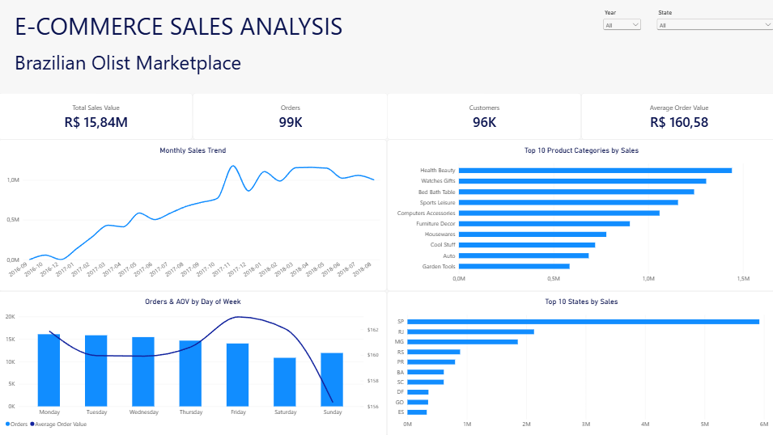
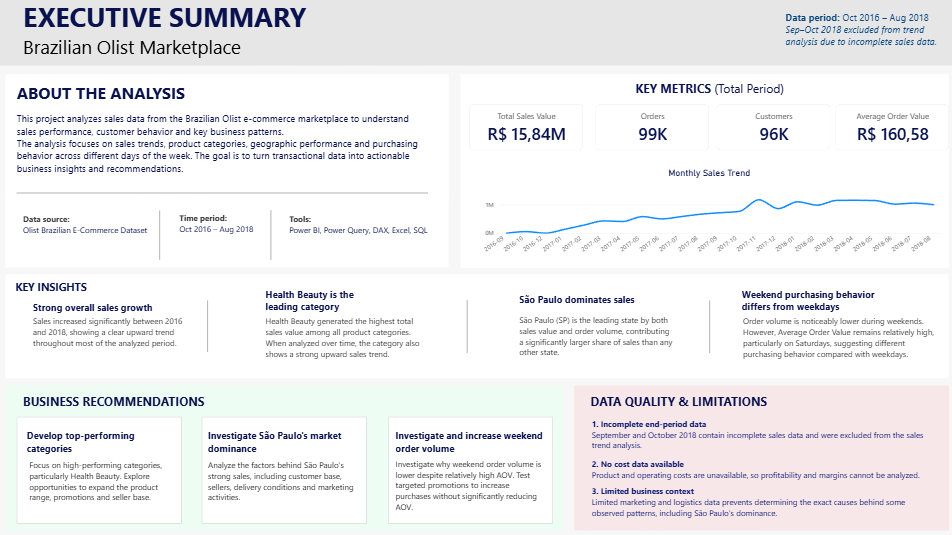

# Olist E-Commerce Sales Analysis

## Project Overview

This project analyzes sales data from the Brazilian Olist e-commerce marketplace to identify key sales trends, customer purchasing patterns, top-performing product categories and geographic differences.

The project covers the complete analytical process — from data preparation and validation to data modeling, DAX calculations, interactive visualization and business recommendations.

The final result is an interactive Power BI report consisting of a Sales Dashboard and an Executive Summary.

## Dashboard

### Sales Dashboard

The main dashboard provides an overview of sales performance and allows users to explore the data by year and state.

### Executive Summary

The Executive Summary presents the main findings, business recommendations and important data limitations identified during the analysis.

## Tools & Technologies

- **Power BI** — data modeling, DAX measures and interactive dashboard development
- **Power Query** — data transformation, cleaning and preparation
- **DAX** — calculation of KPIs and analytical measures
- **Excel** — data exploration, validation, PivotTables, Power Query and lookup/aggregation functions
- **SQL** — exploratory analysis, joins, aggregations, CTEs, window functions and data quality validation

## Data Preparation & Analysis

The analysis included:

- Cleaning and transforming the source data
- Building relationships between orders, customers, products, order items and calendar data
- Creating a dedicated Calendar table for time-based analysis
- Creating DAX measures for sales value, orders, customers and Average Order Value
- Validating data completeness before interpreting sales trends
- Analyzing sales by time, product category, state and day of the week
- Investigating customer purchasing patterns and translating findings into business recommendations

## Key Metrics

| Metric | Result |
|---|---:|
| Total Sales Value | R$ 15.84M |
| Orders | 99K |
| Customers | 96K |
| Average Order Value | R$ 160.58 |

## Key Insights

### 1. Strong overall sales growth
Sales increased significantly between 2016 and 2018, showing a clear upward trend throughout most of the analyzed period.

### 2. Health Beauty is the leading category
Health Beauty generated the highest total sales value among all product categories and also showed a strong upward sales trend over the analyzed period.

### 3. São Paulo dominates sales
São Paulo (SP) generated the highest sales value and order volume, contributing a significantly larger share of sales than any other state.

### 4. Weekend purchasing behavior differs from weekdays
Order volume was noticeably lower during weekends, while Average Order Value remained relatively high, particularly on Saturdays.

## Business Recommendations

### Develop top-performing categories
Continue focusing on high-performing categories, particularly Health Beauty. Further analysis should identify the factors behind their performance and opportunities to expand the product range, promotions and seller base.

### Investigate São Paulo's market dominance
Analyze the factors behind São Paulo's strong sales concentration, including customer base, sellers, delivery conditions and historical marketing activities. These findings could help identify opportunities in other states.

### Investigate and increase weekend order volume
Investigate why weekend order volume is lower despite relatively high Average Order Value. Test targeted campaigns or promotions aimed at increasing weekend purchases without significantly reducing AOV.

## Data Quality & Limitations

### Incomplete end-period data
September and October 2018 contain incomplete sales data. These months were excluded from the sales trend analysis to avoid interpreting incomplete records as an actual decline in sales.

### No cost data available
Product and operating costs are not available in the dataset. Therefore, the analysis focuses on sales value rather than profit, margin or overall profitability.

### Limited business context
The dataset contains limited information about marketing activities, delivery options and other operational factors. As a result, patterns such as São Paulo's sales dominance can be identified, but their exact causes cannot be determined from the available data alone.

## Data Source

The project uses the public **Brazilian E-Commerce Public Dataset by Olist**, containing transactional data from the Brazilian Olist marketplace.

**Analysis period:** October 2016 – August 2018

September and October 2018 were excluded from the sales trend analysis due to incomplete sales records.

## Project Files

- `sales-dashboard.png` — Power BI Sales Dashboard
- `executive-summary.png` — Power BI Executive Summary
- Power BI and Excel source files are not included in the repository due to GitHub file size limitations.

---

*Portfolio project created as part of my Data Analyst development path.*
